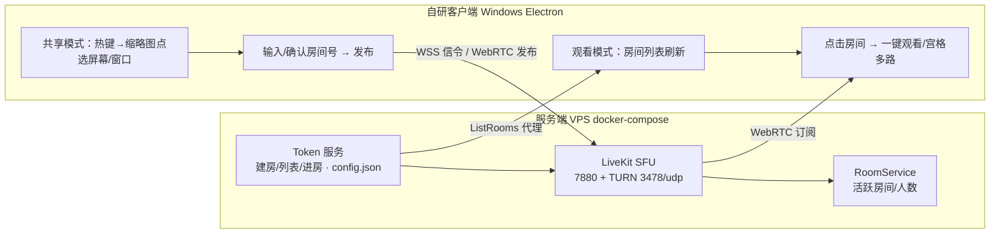

# Windows 快速屏幕共享软件 — 技术方案调研

> 状态：**v1.4 已实现并本地验证**（2026-10-01）
> 决策链：公网云服务器 / Electron 自研客户端（双角色）/ 单房间 ≤10 人 / 一键选择器 / 服务端文件化配置。
> 需求重申（v1.3）：推流端用自研软件推流并**自设房间号**；客户端可**浏览现有房间列表、一键点击观看**，**不走浏览器**。
> 实现位置：`client/`（Electron）、`server/token-service/`（Node 零依赖）、`deploy/`（docker-compose）。本地已验证：建房/查重(409)/口令房(401/200)/列表/停止；浏览器引擎页端到端发布 448ms 出流、观看 286ms 首帧、3 秒 61 帧；观看页 UI 列表→点击→播放通过。Electron GUI 因沙箱无桌面会话未能本机拉起，需在真实 Windows 桌面 `npm start` 复验。

## 0. 已确认决策（2026-10-01）

| 决策点 | 结论 | 落地影响 |
|---|---|---|
| 部署环境 | 公网云服务器 | 需域名 + 自动 TLS；建议 2C4G、≥100Mbps 带宽 VPS，月成本约 ¥30–100 |
| 实现路线 | **确认自研**（方案 B） | 不基于 Screego 二次开发；Screego 仅作功能对照参考 |
| 客户端形态 | Electron，**一个 App 两种角色** | 共享端与观看端同一个 Windows 程序；采集/硬编/WebRTC 交给 Chromium |
| 典型规模 | 单房间 ≤10 人 | SFU 单机绰绰有余（10 观看 × 4Mbps ≈ 40Mbps 出口）；多节点扩展不在本期范围 |
| 房间模型 | 共享者**自设房间号** | 房间号人工可读（如 `210`、`发布会`）；建房时校验唯一性 |
| 观看方式 | **客户端房间列表一键观看** | App 内列出当前活跃房间（房间号/共享者/人数），单击即看；浏览器观看退出主线（降为 M3 可选） |
| 交互形态 | 一键选择窗口/屏幕 | desktopCapturer 枚举屏幕+窗口缩略图，单击即开始共享，不走系统弹窗 |
| 服务端形态 | 文件化配置、无数据库 | docker-compose + YAML/JSON 全文件驱动；房间列表直接查 LiveKit RoomService，不自建注册表 |

## 1. 需求拆解与目标指标

| 维度 | 目标 | 依据 |
|---|---|---|
| 启动速度 | 托盘/快捷键 → 3 次点击内开始共享/开始观看，≤ 3 秒出画面 | "快捷共享/一键观看" |
| 延迟 | 端到端 ≤ 500ms（WebRTC 典型 100–400ms） | 屏幕共享/协作场景要求 |
| 画质 | 1080p 可读文字（代码/表格），码率 2–8 Mbps 自适应 | 办公共享主用途 |
| 共享模式 | 1 人共享 N 人看；N 人共享 M 人看（同房间多路画面） | 明确需求 |
| 房间 | 共享者自设房间号；观看端实时看到现有房间列表 | v1.3 重申 |
| 查看端 | **同一个自研客户端**，列表→点击→观看，全流程不依赖浏览器 | v1.3 重申 |
| 规模 | 单房间 ≤10 人（已确认）；架构可横向扩展 | 服务端架构要求 |
| 安全 | 进房权限、JWT、可选口令、可选 E2EE | 基线要求 |

## 2. 技术分层结论（先给结论，论证在后）

```
采集(WGC) → 编码(H.264 硬编) → 传输(WebRTC/SFU) → 观看(自研客户端订阅渲染)
```

### 2.1 屏幕采集（Windows）— 选 Windows Graphics Capture (WGC)

| API | 能捕什么 | 优点 | 缺点 |
|---|---|---|---|
| **Windows Graphics Capture (WGC)** ✅ | 整屏 + 单窗口 | 官方推荐路径；直接产出 D3D11 GPU 纹理（零拷贝进编码器）；支持系统选择器 UI；Win10 1803+ | 系统默认画黄色边框（`IsBorderRequired` 可申请关闭）；HDR 内容需 R16G16B16A16_FLOAT 管线处理 |
| DXGI Desktop Duplication | 仅整屏 | 效率高（OBS「显示器采集」即此） | 混合 GPU/锁屏/RDP 下易失败；不能捕窗口 |
| GDI BitBlt | 窗口 | 兼容性兜底 | CPU 拷贝、性能差，仅作降级 |

来源：[微软 Screen capture 文档](https://learn.microsoft.com/en-us/windows/apps/develop/media-authoring-processing/screen-capture)、[DXGI Desktop Duplication](https://learn.microsoft.com/en-us/windows/win32/direct3ddxgi/desktop-duplication-api)

注：Electron 的 `getDisplayMedia`/`desktopCapturer` 在 Windows 上底层即走 WGC，无需自研采集代码。

### 2.2 编码 — H.264 为主，硬编优先

- 屏幕内容（文字/代码）H.264 兼容性最好：所有硬件解码器都支持。
- Electron/Chromium 自动调用系统硬件编码器（Media Foundation），CPU 占用低。
- 原生路径（C#/Rust）：注意 **LiveKit Rust SDK 的硬件编码目前只列了 macOS/Linux**（见其 README 特性表），Windows 走软件编码——原生路线已被后置规避。
- 码率参考：办公内容 1080p30 约 2–4 Mbps，高动态视频 5–8 Mbps。`contentHint = "detail"` 保文字清晰。

### 2.3 传输 — WebRTC（SFU 转发），不用 RTMP/HLS

| 方案 | 端到端延迟 | 共享者上行带宽（5Mbps 流 × n 观众） | 结论 |
|---|---|---|---|
| WebRTC P2P mesh | 100–300ms | **n × 5 Mbps**（观众越多共享者越扛不住） | 仅 ≤ 3–4 观众可用 |
| **WebRTC SFU 转发** ✅ | 100–500ms | **1 × 5 Mbps**（服务器承担分发） | 主方案 |
| SRT/RTMP → FLV | 1–5s | 1 × | 延迟不达标 |
| HLS/LL-HLS | 2–30s | 1 × | 仅适合千人级单向直播，非本需求 |

带宽账（SFU）：服务器出口 = Σ(每路码率 × 订阅人数)。≤10 人：1 路 × 4Mbps × 10 ≈ 40Mbps 出口，单 VPS 余量充足。

### 2.4 服务端 — 选型对比

| | **LiveKit Server** ✅ 推荐 | MediaMTX | Screego | RTMP 服务器(SRS/nginx-rtmp) |
|---|---|---|---|---|
| 定位 | 通用 WebRTC SFU | 流媒体路由（协议转换枢纽） | 屏幕共享专用 P2P | 广播直播 |
| 房间/多人共享模型 | **房间内 N 发布者 + M 订阅者，原生支持** | 每个发布者一条 path，房间语义需自己拼 | 多人共享支持，但 mesh 分发 | 一人一路 |
| **房间列表 API** | **RoomService ListRooms（房间名/人数/元数据现成）** | paths API（弱） | 无 | 无 |
| 鉴权 | JWT（canPublish/canSubscribe 细粒度） | internal/HTTP/JWT | 房间密码 | 弱 |
| NAT 穿透 | UDP/TCP/TURN 内置 | ICE 内置 | 内置 TURN | — |
| 延迟 | 100–500ms | WHIP/WHEP WebRTC 同级 | 100–300ms | 秒级 |
| 部署 | 单二进制 / Docker / K8s Helm | 单二进制 | 单二进制 / Docker | Docker |
| 许可 | Apache-2.0 | MIT | 开源 | 各异 |

- LiveKit：生产级（README 列 Salesforce/Nvidia/Oracle 等在用），Go 单二进制。来源：[livekit/livekit](https://github.com/livekit/livekit)
- MediaMTX：WHIP/WHEP 极简管线，但房间语义/列表/权限全要自建。来源：[bluenviron/mediamtx](https://github.com/bluenviron/mediamtx)
- Screego：同类开源（P2P），mesh 分发受限，仅作对照。来源：[screego/server](https://github.com/screego/server)
- OBS 支持 WHIP 输出（`plugins/obs-webrtc`，已验证）：M0 联调期作临时推流端。来源：[obs-webrtc](https://github.com/obsproject/obs-studio/tree/master/plugins/obs-webrtc)

## 3. 候选架构总览

### 方案 A：Screego（现成 P2P）
mesh 上行受限（>4 观众质量骤降）、无房间列表/权限体系，**仅作对照参考**。

### 方案 B：自研客户端 + LiveKit SFU（主线 ✅）
自研 Electron 客户端（共享/观看双角色）→ 公网 VPS LiveKit → 同一客户端内房间列表一键观看。

### 方案 C：MediaMTX WHIP/WHEP 极简管线
无房间语义与列表，多人共享场景绕路；仅 M0 可作旁路验证。

### 方案 D：RTMP→HLS 广播
延迟 6–30s，排除。

## 4. 推荐架构（方案 B）详细设计



### 4.1 组件清单

| 组件 | 技术 | 职责 |
|---|---|---|
| **自研客户端（Windows，双角色）** | Electron + LiveKit JS SDK | 共享：托盘+热键→**自绘一键选择器**（desktopCapturer 屏幕窗口缩略图）→**设置房间号**→发布；观看：**房间列表**（房间号/共享者/在线人数）→单击进房，宫格多路+单击放大 |
| Token 服务 | Go/Node 小服务（百行内，文件配置） | `POST /rooms` 建房（校验房间号唯一）签发发布 token；`GET /rooms` 活跃房间列表（代理 LiveKit ListRooms：房间号/人数/共享者）；`POST /rooms/:id/join` 签发观看 token（仅 canSubscribe） |
| 媒体服务 | LiveKit（官方 Docker 镜像） | SFU 转发、simulcast 自适应、内嵌 TURN、房间状态与列表 |
| 反向代理 | Caddy（自动 TLS） | HTTPS/WSS 统一入口 |

### 4.2 房间模型与典型流程（覆盖"自设房间号 + 房间列表 + 一键观看"）

- 房间号由共享者设置（数字或短文本，如 `210`），建房时 Token 服务查 LiveKit 现有房间查重，冲突即报"房间号已被使用"。
- LiveKit 房间随最后一个参与者退出自动销毁 → **房间列表天然等于"正在进行的共享"**，无需自建注册表、无需数据库；观看端 5–10 秒轮询或订阅刷新。
- 共享流程：热键 → 缩略图点选屏幕/窗口 →（默认房间号可记忆，可改）→ 开始共享 → 托盘气泡提示"房间 210 共享中"。
- 观看流程：打开 App 观看页（或托盘"查看共享"）→ 列表点击 → 1 秒内出画面；多路共享同房间宫格展示。
- 权限：发布 token `canPublish`；观看 token 仅 `canSubscribe`；观众转共享 = 重新签发发布 token（口令房时校验）。
- 可选房间口令：建房带口令 → 进房接口校验后发 token。

### 4.3 客户端形态路线（已定：Electron 双角色）

| | **M1: Electron + JS SDK** ✅ 已选 | M3 备选: Tauri + JS SDK | 远期: C#/Rust 原生 |
|---|---|---|---|
| 采集 | desktopCapturer/getDisplayMedia（底层 WGC） | 同左（WebView2） | WGC + D3D11 自研 |
| 编码 | Chromium 硬编（自动） | 同左 | MF/NVENC（Rust SDK Windows 无硬编→软编吃 CPU） |
| 观看渲染 | `<video>` + livekit-client 订阅，同进程 | 同左 | 自研渲染 |
| 体积/内存 | ~120MB / 250MB | ~15MB / 150MB | ~10MB / 50MB |
| 开发速度 | **天级出 MVP** | 周级（WebView2 采集权限需验证） | 月级 |
| 托盘/热键/自启 | 成熟 API | 成熟 API | Win32 原生 |

### 4.4 安全与公网部署（已定：公网云服务器）

- **必备**：域名 + Caddy 自动 TLS；信令 WSS，媒体 DTLS-SRTP（WebRTC 自带）。
- **必备**端口：80/443 tcp（Caddy：HTTPS/WSS 信令）；7881 tcp（媒体 TCP 回退）；3478 udp（TURN）；50000–60000 udp（媒体）。可选 5349 tcp 开启 TURN/TLS（livekit.yaml 内注释说明）。
- 房间号查重 + 可选口令 + token 有效期（默认 4h）。
- 可选 LiveKit E2EE（SFrame，JS SDK 支持，Electron 内可用）。来源：[LiveKit encryption](https://docs.livekit.io/transport/media/encryption/)
- VPS 规格：2C4G、带宽 ≥100Mbps。

### 4.5 文件化配置设计（已定：全链路走文件，无数据库）

服务端部署物就是一组文件，`git clone` + `docker compose up -d` 即完成架设，无任何数据库依赖：

```
deploy/
├── docker-compose.yml   # LiveKit + Token 服务 + Caddy 三容器编排
├── livekit.yaml         # LiveKit：API 密钥、TURN、UDP 端口段
├── caddy/Caddyfile      # 域名与自动 TLS
└── token/config.json   # Token 服务：密钥、口令开关、token 有效期、房间号规则（可被环境变量覆盖）
```

- 房间状态：完全由 LiveKit 内存态承载（活跃房间=有人共享的房间），重启即清空，无落盘必要；Token 服务无状态。
- 客户端 `config.json`：服务器地址、全局热键、默认房间号、默认清晰度——改文件即切换部署环境。
- 浏览器观看页从主线移除（M3 若有外部访客需求，再以纯静态页形式可选提供）。

## 5. 里程碑

| 阶段 | 内容 | 验收 |
|---|---|---|
| M0 服务端冒烟 ✅ 2026-10-01 | 本地 livekit-server 1.13.7 + Token 服务 | 全部 API 合同验证通过（见文件头状态） |
| M1 MVP ✅ 2026-10-01 | Electron 客户端：共享模式（一键选择器+自设房间号+发布）与观看模式（房间列表+一键观看+宫格）；Token 服务 | 浏览器端到端冒烟通过；Electron GUI 待真实桌面复验（`npm start`） |
| M2 打磨（3–5 天） | 口令房、simulcast 调优、断线重连、窗口模式、观看端自动刷新、托盘通知 | 10 观看 + 2 共享实测（延迟/带宽/CPU 达标） |
| M3 可选增强 | E2EE、录制（Egress）、Tauri 轻量版、浏览器观看静态页（外部访客） | 按需 |

## 6. 风险与缓解

1. **共享者上行带宽**是第一瓶颈：SFU 下共享者只传 1 份上行；家宽推 1080p 默认码率上限 4Mbps + 自适应降档。
2. 房间号是共享者自设的短文本，存在抢注/撞号：建房查重 + 列表实时显示 + 可选口令兜底。
3. 房间列表依赖 LiveKit RoomService（内存态）：服务重启房间即散——对"正在共享"语义反而正确，重启后共享者客户端自动重连重建房间（M2 做）。
4. WebView2（Tauri）`getDisplayMedia` 权限流需实测——后置 M3，不影响 M1。
5. Rust SDK Windows 无硬编（官方特性表）——原生路线已后置规避。

## 附：已验证来源

- LiveKit Server（Apache-2.0，特性/部署/SDK/RoomService）: https://github.com/livekit/livekit
- LiveKit JS 客户端 SDK: https://github.com/livekit/client-sdk-js
- LiveKit Rust SDK（Windows 支持但硬编仅 Mac/Linux）: https://github.com/livekit/rust-sdks
- Screego（P2P 屏幕共享，v1.12.6 持续发版）: https://github.com/screego/server
- MediaMTX（单二进制流媒体路由）: https://github.com/bluenviron/mediamtx
- OBS WHIP 输出插件: https://github.com/obsproject/obs-studio/tree/master/plugins/obs-webrtc
- 微软 WGC 采集文档: https://learn.microsoft.com/en-us/windows/apps/develop/media-authoring-processing/screen-capture
- LiveKit E2EE: https://docs.livekit.io/transport/media/encryption/
